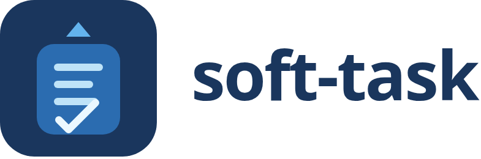
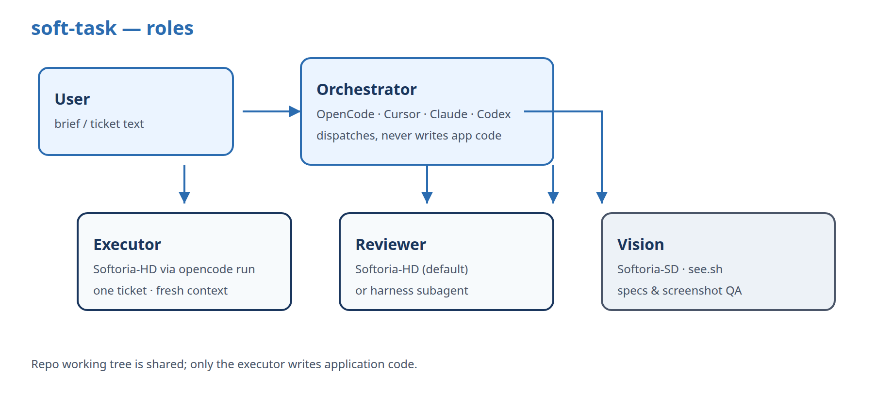
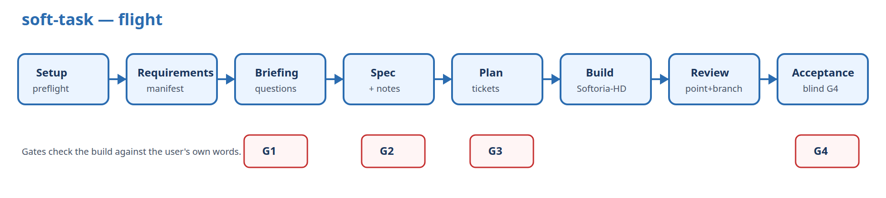
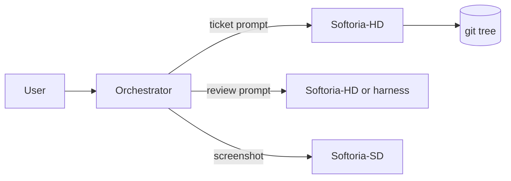

# soft-task

**Task-first AI build framework.** You give a brief or a ticket; soft-task turns it into requirements, a plan, Softoria-HD executors, review, and blind acceptance — with a live dashboard.

Ukrainian intro site: [oleksandr-kupenko.github.io/soft-task](https://oleksandr-kupenko.github.io/soft-task/)

Derived from [Autopilot](https://github.com/nick-vels/skills) (MIT). See [NOTICE](NOTICE).

<p align="center"></p>







## Why soft-task

| Problem | soft-task |
|---|---|
| Vibecoding loses requirements by the third rewrite | Numbered **manifest** + gates G1–G4 against *your* words |
| Long agent sessions rot context | **One ticket → one fresh Softoria-HD process** |
| Company tools are Softoria, not Claude | Default executor / reviewer / vision = Softoria HD & SD |
| Real work is large tasks in existing repos | **`task` depth**: T1–T2, no scaffolding/ADR unless asked |
| Everyone uses a different agent | Orchestrator = OpenCode, Cursor, Claude Code, or Codex |

## Quick install

```bash
# from a clone (no npm publish required)
git clone https://github.com/oleksandr-kupenko/soft-task.git soft-task
cd soft-task
node bin/soft-task.mjs install --harness all --yes

export SOFT_TASK_ROOT="$PWD"
export SOFTORIA_API_KEY="…"   # never commit this

node bin/soft-task.mjs doctor
```

Later, from any machine:

```bash
npx github:oleksandr-kupenko/soft-task install --harness all --yes
```

`--yes` merges the Softoria provider + vision agent into `~/.config/opencode/opencode.json` with `apiKey: "{env:SOFTORIA_API_KEY}"`. Existing keys are never read or copied.

## Run a task

In OpenCode / Cursor / Claude Code / Codex, after install:

```text
/soft-task task Fix invoice pagination — accept criteria in the pasted ticket below
```

or

```text
/soft-task semi path/to/brief.md
```

Modes: `full` · `semi` (default) · `interview` · `manual`  
Depth: `strict` · `normal` (default) · `deep` · **`task`**

The agent opens a dashboard at `http://127.0.0.1:<port>/dashboard.html` (EN / UK / RU).

## Layout

```
soft-task/
  bin/soft-task.mjs          install · doctor · uninstall
  skill/                     orchestrator skill (SKILL.md + phases + adapters)
  engines/
    softoria-hd/             run.sh · diff.sh
    vision/                  see.sh (Softoria-SD)
    playwright/              shot.mjs
    testing/                 detect-stack.sh · http-smoke.sh
  opencode/                  provider fragment + /soft-task command
  docs/                      flow + diagrams
```

Per project, soft-task writes `.soft-task/` (committed): brief, manifest, spec, tickets, dashboard state.

## Roles

1. **Orchestrator** — your session agent. Reads phases, runs `st.py`, never writes app code.  
2. **Executor** — Softoria-HD via `opencode run --standalone` (fresh context per ticket).  
3. **Reviewer** — Softoria-HD by default; set `engines.reviewer: "harness"` to use the host agent’s subagent.  
4. **Acceptance** — the blind checker (G4); `engines.acceptance`, same values.  
5. **Helper** — agents that write no project code (repo exploration, G2 reader, ADR, memory); `engines.helper`, same values.  
6. **Vision** — Softoria-SD through `engines/vision/see.sh` for design specs and screenshot QA.

Every agent launch is routed by role in `skill/phases/engines.md`; the orchestrator never does a role's work itself. Harness details: `skill/adapters/{opencode,cursor,claude-code,codex}.md`.

## Testing helpers

- `engines/testing/detect-stack.sh` → `.NET` / PHP / Node / Python / Go check command  
- Scoped tests in each ticket; orchestrator re-runs them before commit  
- `engines/testing/http-smoke.sh` for API blind acceptance  
- `engines/playwright/shot.mjs` + `see.sh` for UI tickets  

## FAQ

**VPN or 502?** Softoria API needs the corporate VPN. `engines/softoria-hd/probe.sh` tells the two failures apart: no connection means VPN, an HTTP 5xx/429 means the Softoria gateway itself. On a gateway error `run.sh` retries up to 3 times (30/90/180 s) and resumes the **same session**. If the gateway is still down, the orchestrator pauses the tickets and starts `wait-softoria.sh` as a tracked background job. Its exit wakes the orchestrator, which then resumes every paused ticket by session. `soft-task doctor` runs the same probe.

**No vision?** Softoria-HD is text-only. Visual tickets always go through Softoria-SD (`see.sh`). Backend-only tasks skip vision.

**Backend (.NET / PHP)?** Use `task` depth. Stack detector picks `dotnet test` / Pest / PHPUnit. Add `smoke.urls` for G4 HTTP checks.

**Update?** Re-run `install`. There is no phone-home update check.

**Secrets?** soft-task never asks for key *values*. Set `SOFTORIA_API_KEY` yourself. Briefs are redacted before they hit disk.

## License

MIT. Upstream attribution in [NOTICE](NOTICE).
